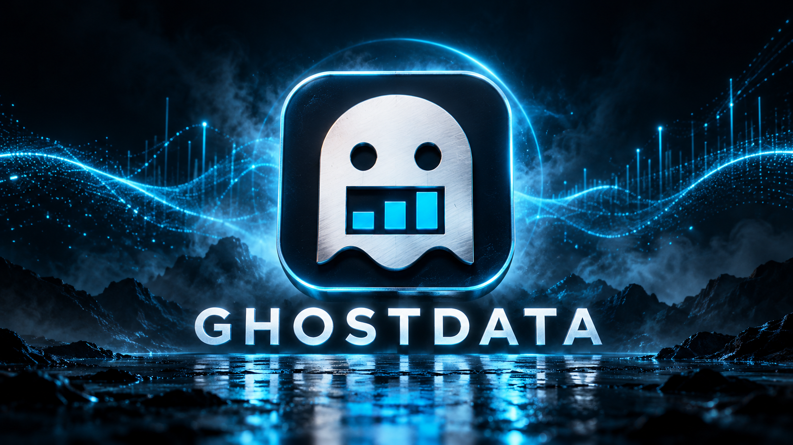
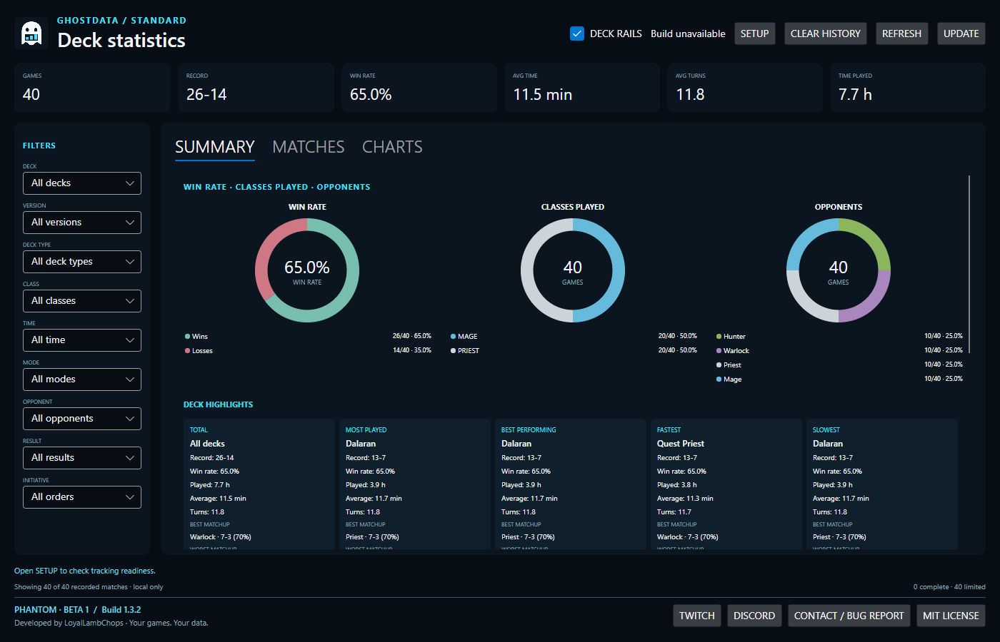
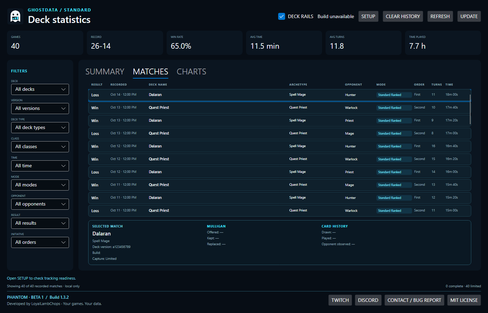
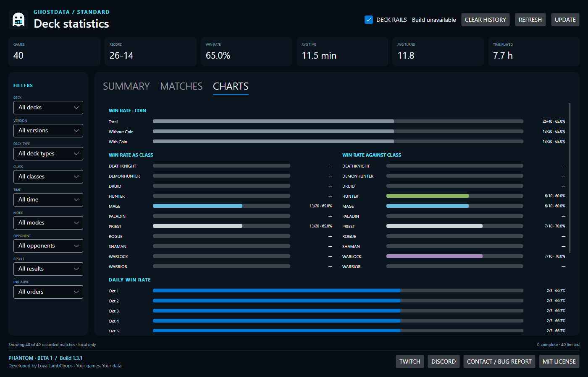
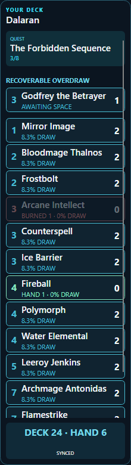
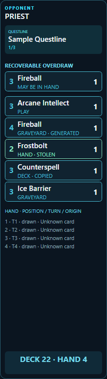
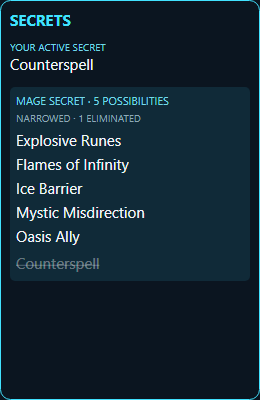

# GhostData — Phantom · Beta 1

GhostData is a local Windows dashboard and deterministic deck tracker for Hearthstone Standard.

Developed by **LoyalLambChops** · **LoyalLambChops@gmail.com**.
**Free software under the [MIT License](LICENSE).** Phantom · Beta 1 (build 1.3.9) includes a Windows installer, branded shortcuts, bundled runtimes, and in-app community/contact links.

**[Download GhostData for Windows — installer](https://github.com/LoyalLambChops/GhostData/releases/download/v1.3.9/GhostData-Setup-1.3.9-x64.exe)**

Windows 11 x64 · Unsigned beta · [Release notes, checksums and alternative portable ZIP](https://github.com/LoyalLambChops/GhostData/releases/tag/v1.3.9)

Download and run the installer. That single file includes everything GhostData needs; no build commands or separate runtime installation. Normal tracking keeps match history and analytics on your machine. The repository contains the application, sensor, build tooling, manuals and synthetic tests; personal data, captured logs and private promotional material are excluded.

It records completed matches across Hearthstone log sessions and presents results, deck identity, deck composition versions, opponent classes, initiative, match duration, mulligan choices, and factual card history. The live rails provide deterministic deck accounting, observed opponent history, hero-zone effects, and separately labeled Secret possibilities. It does not provide turn-by-turn advice or make causal claims about why a game was won or lost.

**1.3.9 patch:** fixes private Assemble-choice disclosure, Godfrey recovery rows, Grueling Trial rail text and game-bound deck identity.

**Beta scope:** compact text rails, quests, separate Secret possibilities, recoverable overdraw, automatic logging setup and local card-definition import. Hand hover shows supported summon/replay/stored-card results without duplicating ordinary card descriptions. Rail hover retains full text and broader tracked context. Some specialized mechanic previews remain incomplete; see [coverage and limits](docs/HAND_PREVIEWS.md). Turn timers and additional counters are planned after beta.

## See GhostData

The screenshots below show the actual **GhostData Phantom · Beta 1** dashboard with **synthetic sample data**, not personal match history or measured performance. Preview mode runs without attaching to Hearthstone, so the game build is shown as unavailable.

### Statistics dashboard

### Matches tab

### Charts tab

### Deck rails and Secret tracker

| Player rail | Opponent rail | Secret tracker |
| --- | --- | --- |
|  |  |  |

## Product surface

- One local Summary / Matches / Charts dashboard with deck/version and matchup statistics.
- In-match opponent-left and player-right deck rails, enabled by default and controlled from the dashboard.
- A separate Secret tracker, retained quest progress, readable card names and draw odds, and text card-detail previews.
- Verified Standard Secret candidate tracking with conservative public non-trigger elimination.
- Background local match recorder while the dashboard is open.
- Multi-session `Power.log` discovery so Hearthstone restarts do not split or lose history.
- Persistent source index so unchanged historical sessions are not reparsed on every Refresh.
- Actual Hearthstone deck name when the selected-deck sensor can read it.
- Exact deck-composition fingerprint kept separately from deck name.
- Factual match, mulligan, draw, play, and public opponent-card history.
- Local storage under `%USERPROFILE%\GhostDataData` by default.

## Requirements

- Windows 11 x64 and Hearthstone. GhostData configures Power.log logging automatically; an already-running game may need one restart.
- The installer and portable package bundle Python and .NET 10. The sensor uses Windows' .NET Framework 4.8.
- Building from source additionally requires Python 3.12+ and the .NET 10 SDK.

## Start

Use the **[Windows installer](https://github.com/LoyalLambChops/GhostData/releases/download/v1.3.9/GhostData-Setup-1.3.9-x64.exe)**. It installs for the current user, creates a Start Menu shortcut, offers a Desktop shortcut, and can launch GhostData when setup finishes. No build step or command prompt is needed. Windows uninstall preserves your local match history. This beta is unsigned; Windows may warn or block it under its security policy.

For the portable package, extract the entire ZIP to a writable folder and open
`GhostData.App.exe`. Keep the folder together. Start Hearthstone and reach its
main menu to import local definitions. Click **UPDATE** for a local card refresh
and a GitHub release check; verified engine updates install on application exit.

From source, run `Build-GhostData.cmd` once, then `Run-GhostData.cmd`.
Maintainers create a self-contained package with `tools/Build-Portable.ps1`, then build Setup with `tools/Build-Installer.ps1` and the official Inno Setup compiler. See the [release checklist](docs/PUBLIC_RELEASE_READINESS.md) for remaining gates.

The build publishes a Windows x64 application under `app/GhostData.App/bin/Release/win-x64`.
Other operating systems' native libraries and debug symbols are excluded from that output.

The Python backend uses only the standard library. The selected-deck sensor build downloads a pinned MIT-licensed UnitySpy source revision and preserves its license beside the built sensor.

See `START_HERE_GHOSTDATA.md` for the validation workflow.

Read the [complete user manual](docs/USER_MANUAL.md) for setup, controls, card
states, statistics, images, backup and troubleshooting. The separate
[technical manual](docs/TECHNICAL_MANUAL.md) covers architecture, data contracts,
builds, tests and maintenance. Both describe current behavior and its limitations.

See [third-party notices](THIRD_PARTY_NOTICES.md) and
[tracking coverage and verification](docs/tracking_coverage.md).

## License and community

GhostData's original source and documentation are licensed under MIT, copyright (c) 2026 LoyalLambChops. MIT permits use, modification and redistribution, including commercial use, with the required notice. Bundled components retain their respective licenses: see [third-party notices](THIRD_PARTY_NOTICES.md). The software license does not grant rights to Blizzard content or trademarks.

[Website](https://loyallambchops.github.io/ghostdata-site/) · [Discord](https://discord.gg/H3Et7NHavZ) · [Twitch](https://www.twitch.tv/loyallambchops) · [Email / bug reports](mailto:LoyalLambChops@gmail.com)

Dashboard buttons open your browser or an email draft. No logs or history are automatically attached or sent. The **MIT LICENSE** button works offline.

## First-run setup and release process

GhostData enables Power logging and imports local card definitions automatically. If Hearthstone was already running when logging was first enabled, restart the game once. **SETUP** remains available for diagnostics or a custom game folder; normal startup needs no setup buttons. Settings remain in your separate data folder.

[Privacy](PRIVACY.md) · [Support](SUPPORT.md) · [Security](SECURITY.md) · [Contributing](CONTRIBUTING.md) · [Release procedure](docs/RELEASE_RUNBOOK.md)

The Windows packaging workflow produces tested candidate artifacts. Public downloads remain pending the clean-Windows/live acceptance and repository privacy checks.
