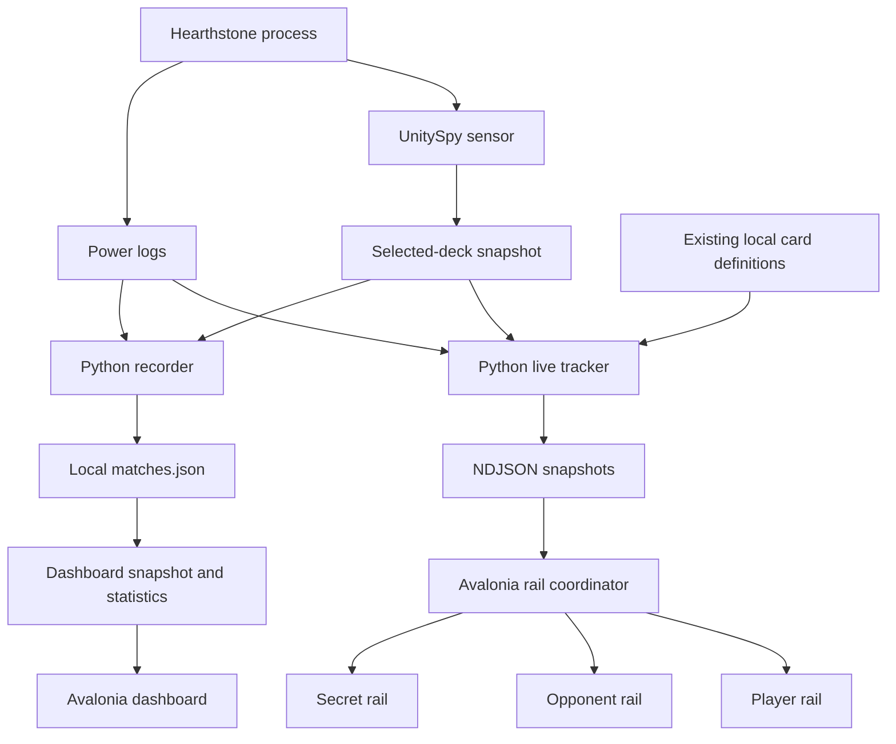

# GhostData technical manual

Version 1.2.0 - Updated October 21, 2026

This manual describes the application in this repository: a Windows Avalonia
dashboard and deterministic Standard tracker, backed by Python and an open-source
UnitySpy selected-deck sensor. It is a standalone application with its own engine.
The [user manual](USER_MANUAL.md) covers operation; the
[validation ledger](parity_validation.md) records evidence and remaining gates.

## Contents

1. [Architecture and boundaries](#architecture-and-boundaries)
2. [Repository map](#repository-map)
3. [Processes and scheduling](#processes-and-scheduling)
4. [Log ingestion and recovery](#log-ingestion-and-recovery)
5. [Selected-deck sensor](#selected-deck-sensor)
6. [Tracker model and reconciliation](#tracker-model-and-reconciliation)
7. [Secrets, quests and public effects](#secrets-quests-and-public-effects)
8. [Transport and UI](#transport-and-ui)
9. [History and statistics](#history-and-statistics)
10. [Artwork and metadata](#artwork-and-metadata)
11. [Storage and configuration](#storage-and-configuration)
12. [Build, test and publish](#build-test-and-publish)
13. [Maintenance and acceptance](#maintenance-and-acceptance)

## Architecture and boundaries



The sensor reads selected-deck client state; Power logs establish observed game
transitions. Public-state tracking and explicit card rules produce displays.
Unknown information stays unresolved. No remote inference or cloud match-history
service participates in the processing pipeline.

The supported mode predicate permits empty historical tags or Standard format
with recognized constructed ranked/casual/friendly tags. Explicit other formats
and modes are rejected. There is no replay product, tactical recommender,
automated play or opponent archetype-completion engine.

## Repository map

| Path | Responsibility |
| --- | --- |
| `ghostdata.py`, `ghostdata/cli.py` | Python command entry and dispatch. |
| `ghostdata/paths.py`, `models.py`, `store.py` | Data paths, persistent DTOs, local history merge. |
| `ghostdata/powerlog.py`, `recorder.py` | Session discovery and completed-game capture. |
| `ghostdata/log_tail.py`, `tracker_bridge.py` | Incremental live reads, recovery, sensor/metadata scheduling and NDJSON. |
| `ghostdata/deck_sensor.py` | Sensor process wrapper, cached snapshot and composition hash. |
| `ghostdata/tracking/parser.py`, `models.py` | Entity/tag reconstruction and transient game model. |
| `ghostdata/tracking/tracker/` | Deck accounting, provenance, rows, hand slots and sideboard pools. |
| `ghostdata/tracking/secrets.py`, `secret_rules.py`, `standard_secrets.py` | Candidate state, evidence rules and ordinary Standard catalog resolution. |
| `ghostdata/tracking/public_effects.py`, `timeline.py`, `scope.py` | Explicit public effects, transaction rollback and supported-mode predicate. |
| `ghostdata/tracking/card_db.py` | Optional build-specific card definitions and DBF mapping. |
| `ghostdata/dashboard.py` | Persistent history to dashboard DTO conversion and aggregates. |
| `app/GhostData.App/` | Dashboard, three rails, native window integration, text previews and view models. |
| `sensor/` | .NET Framework sensor, pinned UnitySpy preparation and compatibility patches. |
| `launcher/` | Desktop verification/build/launch entry point. |
| `data/intelligence/` | Bundled patch-scoped deterministic data, including Standard Secrets. |
| `tests/` | Python regressions, C# contract harness, preview fixtures. |
| `docs/` | Manuals, field checklists, parity scope and evidence ledger. |

## Processes and scheduling

`DashboardWindow` owns the application's lifetime. Normal startup creates a
continuous Python recorder and a separate Python tracker through C# process
wrappers. Tracker stdout carries snapshots; stderr carries diagnostics. Recorder
stdout/stderr are continuously drained to avoid pipe backpressure, while recorder
diagnostics are written to the local runtime log.

| Work | Current scheduling |
| --- | --- |
| Recorder loop | CLI default two seconds; continuous recorder clamps minimum to one second. |
| Tracker loop launched by GUI | Explicit `--interval 0.25`; bridge sleep minimum 50 ms. The CLI's own default interval is two seconds if no override is supplied. |
| Selected-deck polling | Approximately every three seconds, subject to worker availability. Sensor timeout defaults to four seconds. |
| Sensor and card metadata | One shared `ThreadPoolExecutor` worker; results applied on the tracker thread. |
| Metadata retry | On build change, otherwise five-minute retry delay for the same build. |
| Rail state/placement tick | 150 ms; consume the latest pending snapshot. |
| Hover cursor sampling | 50 ms while visible; card-details hover delay about 150 ms. |
| Dashboard history check | Four seconds, with cache keyed by history write time, length and local date. |

The one-worker I/O queue prevents slow sensor/metadata operations from blocking
log parsing, though it can delay the next sensor read. Identical selected-deck
snapshots skip unnecessary reconciliation. The UI keeps the newest pending
snapshot, rather than replaying every intermediate visual update.

Closing the dashboard cancels/kills owned children and closes its rails.
Minimization preserves them. A tracker exit currently reports through the
backend's failure event; the coordinator does not implement an automatic
supervised restart loop. Reopening the application is the operational recovery.
Do not document it as a Windows service or crash-resilient supervisor.

## Log ingestion and recovery

### Source discovery

Default discovery scans both Program Files Hearthstone `Logs` roots for
`Power*.log`, resolves/deduplicates paths, and orders dated sessions
deterministically. CLI `--power-log` accepts a specific file or directory tree.
The GUI currently passes neither a custom path nor a custom discovery setting.

The recorder considers all changed sessions. The live tracker follows the
latest discovered source. These are different requirements: historical recovery
must not treat the newest file as the complete match archive.

### Live byte and line handling

`LogTail.read(path)` returns `(new_bytes, reset_required)`. It opens the file first,
then reads device/inode identity and size from that handle. This avoids comparing
metadata for one pathname target with bytes from another after a rename.

A different resolved path, changed file identity or smaller size resets the
cursor. Otherwise, the reader compares up to the last 4,096 consumed bytes with
the same region in the open file. This catches common truncate-and-rewrite cases
that regrow beyond the old cursor before the next poll. Only successful reads
commit identity, cursor and anchor; temporary sharing/open errors remain retryable.
The anchor has bounded storage and adds at most 4 KiB of comparison reads per poll.

This is a continuity check, not a full-file integrity hash. An in-place rewrite
that preserves both file identity and the sampled suffix can escape detection.
The parser also cannot make a concurrently rewritten file into an atomic snapshot.
Unconsumed file bytes are currently read in one chunk; only the continuity anchor
is capped at 4 KiB, not the whole ingestion buffer.

`ingest_tracker_chunk` buffers the trailing incomplete line, decodes complete
UTF-8 lines with replacement for malformed bytes, and parses/observes each line
before advancing. The engine therefore sees intermediate zone changes within
one filesystem read. A reset drops partial bytes, runtime entities, deductions
and transaction history, preserves the selected-deck baseline, and forces a new
publication. The UI receives one resulting snapshot per changed chunk/state.

### Completed-game capture

The recorder uses `source_index.json` schema 2 to skip unchanged size/mtime pairs.
Changed logs are parsed for completed games. The current history epoch excludes
games completed before the recording period. A missing store can trigger rescans
of indexed sources that previously contained eligible matches.

One exclusive `recorder.lock` file coordinates writers. The lock has an eight-second
acquisition timeout and a 30-second stale-age recovery rule. Long scans exceeding
that age are an edge case; this is not a transactional database lock with heartbeat.

Selected-deck metadata is attached only to the newest new eligible completed match
from the current, recently modified source and only where deck identity is absent.
This limits accidental assignment of today's deck to old recovered sessions.
The current selected deck is still not a historical truth source for every game.

## Selected-deck sensor

The sensor targets x64 .NET Framework 4.8. `Prepare-UnitySpy.ps1` prepares the
MIT-licensed `Zero-to-Heroes/unity-spy-.net4.5` source pinned to
`ac5f555b76dadcbf2a1a0c98bd7de14c0c623ced`, applies local compatibility patches,
and records provenance in a vendor manifest. The downloaded vendor directory is
ignored by Git. Build-time download is distinct from gameplay networking.

Python invokes `GhostData.Sensor.exe selected-deck --json`, optionally passing
the cached selected deck ID. The normal executable location is `sensor/bin`.
The wrapper accepts `ok`, `exact` and `partial` payloads with useful deck data.
It retains deck name, selected ID, heroes, main cards, sideboards, format/build
and sensor status. A failed read can return the cached deck snapshot.

Deck composition fingerprints are uppercase SHA-256 over canonical JSON containing
sorted main `(card_id, count)` and sideboard `(owner_card_id, card_id, count)` tuples.
The hash is a content identity, not an anonymization mechanism. Names and IDs
remain separate fields. Changes to sideboards affect the fingerprint.

The bridge resolves card IDs/DBF IDs through card metadata. It does not seed an
exact main-deck baseline from a partially unmapped main list. Sensor status must
be EXACT for an exact seed. Every sideboard card, owner and positive count must
also map successfully; otherwise the new seed is withheld rather than silently
shortening a source pool. Sensor fallback
does not prove freshness, and the current capture path does not assign archetypes.

## Tracker model and reconciliation

The parser's transient model contains game/player state, entity IDs, tags, zone,
controller, public identity, choices, action blocks and observations. The deck
engine maintains entity history plus starting-card multiplicities. It derives
player rows, public opponent history, hand slots, source-owned sideboards,
hero-zone effects, counts and accounting status.

Core contracts:

1. Original copies, generated copies and public transformations retain distinct
   provenance. Depleting an original card does not remove the baseline row.
2. Concealed opponent identities do not become public just because a log field
   or sensor can contain an ID. Display permission follows public evidence.
3. Setaside acquisition and linked hand-copy events consume a sideboard source
   once; duplicate streams must not consume it twice.
4. Exact probabilities require reconciled total accounting. PARTIAL exposes a
   discrepancy rather than normalizing uncertain counts into a precise percentage.
5. Public placement tracks actual copies: top order takes precedence, bottom
   copies are excluded while cards remain above them, and shuffles invalidate order.
6. Replacement decks, known shattered multisets and Demon Portal use explicit
   rules rather than assuming every entity belonged to the original 30 cards.

These are bounded rules with tests, not an assertion that every new card's behavior
can be inferred automatically. See [implemented behavior](tracking_coverage.md) and the
effect registry for the named card cases.

## Secrets, quests and public effects

### Secret candidate states

`SecretTracker` maintains candidates by active Secret entity/controller, public
class/source and activation. Eliminations derive from public actions and eligible
conditions, not guessed hidden identities. The candidate set and eliminated set
are both transported for display.

`secret_rules.py` defines supported conditions: plays, attacks, target restrictions,
damage/survival, minion deaths, draws, hero powers, mana and turn transitions.
Board/hand capacity, dormancy, action timing and controller ownership matter.
Nested action boundaries defer decisions until relevant evidence is available.
Disruptive Secret triggers can invalidate otherwise tempting deductions; the
tracker withholds those deductions rather than treating an interrupted action as
an ordinary non-trigger. Safe armor-only cases retain their supported evidence.

Ordinary candidates use collectible Secret definitions whose currently resolved
client set is active in Standard. A matching game build and unexpired rotation
snapshot are required. No packaged historical catalog establishes current legality.

Supported historical generators use explicit public source pools. New game builds,
rotations, generators and trigger semantics require review. Never widen an unknown
pool to every Secret in history simply to fill the UI.

### Quests and hero-zone effects

Quest, questline, sidequest and supported objective tags populate owner-specific
hero-zone rows with progress. These remain independent of the dedicated Secret
overlay and retain their existing GhostData semantics.

### Public generation and Rewind

`public_effects.py` provides explicit source/effect frames for deterministic
generation, public copies and placement. Frames attach to actual created entities
in canonical or TaskList blocks; duplicated/delayed streams cannot manufacture
extra known cards. Random effects may yield a public constraint or unresolved
pool without identifying a concealed hand slot.

`timeline.py` supports in-game Rewind correction. The active game's journal keeps
at most 512 KiB of log text in memory before spooling to a temporary file. Rollback
undoes the most recent PLAY transaction while respecting canonical and TaskList
streams and later retried plays. Completed-match extraction uses corrected lines
too. Journals close at game/source reset. This temporary transaction mechanism
does not provide a replay UI, retained match replay file or replay export.

## Transport and UI

The tracker emits one JSON object per line with `schema_version: 1`,
`message_type: "TRACKER_STATE"`, `event_type: "DECK_TRACKER_UPDATED"`, increasing
`sequence`, and `payload.tracker`. The tracker payload includes revision/activity,
deck identity/counts, player/opponent rows, hand/sideboard/effect state and
`secret_reads`. Python dataclasses and the C# DTOs are the field-level contract;
update them together when changing the wire format.

`TrackerBackendProcess` reads stdout and deserializes envelopes. Malformed JSON
is a diagnostic rather than a UI state update. `DeckRailCoordinator` stores the
newest pending DTO under a lock, applies it on the dispatcher tick, then positions
independent player, opponent and Secret windows. The dashboard is not their native
owner, so minimizing it does not automatically hide them.

The native locator requires a suitable visible foreground Hearthstone window.
The layout calculator converts game pixel bounds into scaled DIP sizes and screen
positions. Rails are non-activating tool windows with click-through behavior.
The shared hover controller samples card bounds, shows one inward-facing text
preview, and intercepts wheel input only over an eligible overflowing rail.

Card names use 15 DIPs, details 11 DIPs, and Deck/Hand totals 16 DIPs. Widths
range from 180 to 220 DIPs; heights cap at 780 DIPs while reserving the bottom
quarter of the game. Long lists scroll without shrinking text. Native behavior has sample pointer/wheel coverage and layout contract
tests, but combined live reconnect/mixed-DPI/focus transitions remain open gates.

The app targets `net8.0` and uses Avalonia/desktop/Fluent packages at 12.1.2.
Statistics charts are local controls; no browser dashboard or extra chart package
is part of the implementation. The .NET 10 SDK is required for the current build
tooling/analyzers even though the application's runtime target remains .NET 8.

## History and statistics

`matches.json` is a schema-1 wrapper around `MatchRecord` values. Records include
identity/timestamps/result, classes/initiative, mode/build, duration/turn count,
deck name/ID/version/type, mulligan lists, own draw/play events, opponent public
events, data quality and source session/game index.

The store deduplicates by match ID and a logical fallback key. Merge fills missing
fields and empty event lists instead of replacing known data indiscriminately.
Writes use a sibling temporary file and `os.replace`. This protects individual
file replacement; match history, index and epoch are not one cross-file transaction.
There is no database migration framework, automatic backup or corruption-repair UI.
Malformed/unreadable history can load as empty, so preserve a copy before diagnosis
and do not treat an empty dashboard as proof the file never contained data.

Clear history writes an empty store, advances the epoch and resets source index.
The dashboard stops its recorder during that operation and restarts it afterward.
CLI `--clear-history` has no interactive confirmation. First-time dashboard access
establishes an epoch; a rescan respects it rather than importing every old log.

The dashboard backend supplies all eligible stored records, without a 200-match
cap. C# applies shared deck/version/type/class/time/mode/opponent/result/initiative
filters and recalculates visible aggregates. Deck detail grouping uses deck ID
when present, otherwise class/name, plus the full composition fingerprint.
Displayed version shortening does not truncate the grouping key. The deck-name
filter can intentionally cover multiple identities with equal names.

Statistical contracts:

- Win rate is `100 * W / (W + L)`; ties remain in Games but not the denominator.
- Duration/turn display averages use positive known values; total time sums
  positive durations. Empty decided samples show unavailable rates.
- Best-performing deck score is `N / (L + 1) * min(1, N / 10)`, with `N = W + L`.
- Most played uses filtered deck game count. Fastest/slowest require more than
  one game and sort mean stored turn count, including zeros in that ranking.
- Best matchup sorts rate descending, losses ascending, wins descending. Worst
  reverses rate/loss priorities. Neither imposes a minimum sample size.
- Daily rates group local dates; class/Coin rates use decided games; distributions
  use matching records. Today starts at local midnight; 7/30-day filters roll.
- Mulligan counts are per-game membership, not copy counts. Kept and replaced
  membership can overlap for a duplicate card name in one opening hand.
- COMPLETE requires core result/class/initiative/time fields plus deck name or
  fingerprint. It does not guarantee a complete game transcript.

The sensor currently supplies an empty archetype label, so type filtering is
available for populated records but does not classify a new deck automatically.
Quality totals reflect the loaded snapshot, not recalculated filtered quality.
History is loaded into memory as a whole; unlimited display count is not a claim
of constant-memory storage or UI virtualization at arbitrary archive size.

## Artwork and metadata

### Text-only presentation

Card rows are immutable text/state view models. No tile request, image decoder,
HTTP client, image cache or artwork preference remains in the application.
`RailHoverPreview` displays known names and stripped rules text, retaining the
150 ms dwell, inward placement, hidden-identity guard and non-activating windows.
The old artwork folders and settings are never read by this candidate.

### Card definitions and rotation

`LocalCardDataReader` uses the retained UnitySpy implementation to read only
public client definitions. `card-data` emits a UTF-8 schema-1 envelope containing
source `BLIZZARD_LOCAL_CLIENT`, installed build/version, verified log build, assembly SHA-256,
import time, validity deadline and card rows. Names/text use the client's current
locale. Text-based trigger recognition is conservative; unsupported localized
wording yields no speculative elimination.

Build identity comes from the installed `.product.db`; the Unity executable's
file version is not a Hearthstone build. Constants come from reflection-only
metadata on `Assembly-CSharp.dll`, which is never executed by the importer.
The importer also decodes the constant printed by `GameState.DebugPrintGame`
from that assembly's IL. The installed expansion client reports 255130 while its
log prints 254477. This verified pairing permits matching local definitions to
the log without accepting arbitrary older builds; absent or ambiguous constants
fail closed. The assembly fingerprint binds the pairing to the imported client.
Card/CardTag tables supply public properties; CardSetTiming and CardSet resolve
first-active membership and Standard legality using initialized EventTimingManager
dates. Forced developer event overrides fail closed. The game process, installed
version and assembly fingerprint are checked across the read. A game updated on
disk after startup must restart before import.

Python validates completeness, source, unique card/DBF identities, matching build,
rotation expiry and required fields. It writes a private temporary file, flushes
and atomically replaces `local_cards/cards_{BUILD}_local.json`. No remote card
metadata path exists. A failed import leaves the prior snapshot intact. The
loader retains prior successful build identity when a new file is malformed.
Legacy artwork and metadata cache folders are not consulted.

The bridge shares one I/O worker between selected-deck polling and imports so
log ingestion stays responsive. It refreshes once per startup, on a newer build,
on expiry and via user-requested Update. Failed reads retry after 60 seconds.
A two-second file timestamp check adopts explicit refreshes. Legality expires at
the earliest future event boundary or after 24 hours; stale/build-mismatched
Secret pools are withheld. Current local membership replaces the obsolete
bundled rotation catalog. Explicit synthetic catalogs remain injectable in tests.

### Recoverable overdraw

`tracking/overdraw.py` records publicly burned originals and newly created
recovery entities for the Atlas trigger. Records live in GameState, so normal
reset and Rewind restoration include them. Duplicate streams cannot duplicate
burns. Hand returns consume local records; a unique opponent return can be
identified, while multiple possibilities persist until public reveal or complete
return. `player_overdraw_rows` and `opponent_overdraw_rows` are additive tracker
DTO fields. They have their own rail section and do not increase hand counts.
No hidden hand identities are queried through the sensor.

### Assemble

Public `ASSEMBLED_MINION` and `CRAFTABLE_SECOND_HALF_DBID` tags identify the
visible body and rules component. Current COST/ATK/HEALTH tags describe the result.
The rail groups different components and current stats separately. Its text
preview uses the second component's rules instead of the original body's rules;
missing components are explicitly unavailable. Opponent details require a public
reveal and are suppressed again on concealment. Hover identity includes name and
details so two rows sharing a base card ID cannot retain each other's preview.

### Explicit releases and portable packaging

`--update` independently attempts local import and a stable release check against
`api.github.com/repos/LoyalLambChops/GhostData/releases/latest`. Normal tracking
never invokes release networking. The downloader accepts only the exact project's
versioned Windows asset and restricted HTTPS redirects, bounds compressed and
expanded sizes, validates the API-provided SHA-256 digest, rejects unsafe/duplicate
archive paths, and verifies a complete per-file manifest. Integrity relies on
HTTPS and the repository's release permissions; this is not a separately signed
software-update system.

Source checkouts cannot be replaced. Portable installations are verified before
staging and again after shutdown; extra or modified files block replacement to
protect user content. A sibling stage is fully built before any move. The external
PowerShell helper waits for the app, verifies both packages, moves the previous
folder aside, moves the stage into place and starts the new UI. Failed startup
attempts rollback. Successful UI acknowledgement removes the temporary previous
folder. Interrupted installs retain recovery directories and an install log under
`%TEMP%/ghostdata-install-*`; do not claim power-loss-atomic installation.

`tools/Build-Portable.ps1` tests, publishes self-contained .NET 8 Windows x64,
builds the .NET Framework sensor, preserves UnitySpy's license, downloads a pinned
official embeddable Python 3.14.8 archive with its published SHA-256, and creates
`GhostData-win-x64.zip`. It contains no game definitions/artwork. The embedded
interpreter's isolated path file exposes only its standard library and the app.
Python bytecode writes are disabled during normal entry-point startup. Maintainer
builds need networking for dependencies; end users do not need a Python/.NET SDK.
New card mechanics still require reviewed engine changes and regression evidence;
Blizzard patch notes cannot supply executable GhostData updates.

## Storage and configuration

Default root is `%USERPROFILE%\GhostDataData`. Python resolves an explicit
`--data-dir` first, then `GHOSTDATA_DATA_DIR`, then the default. The GUI uses the environment/default root. Supply absolute, nonblank environment
paths consistently to avoid subprocess/UI disagreement.

| Interface | Supported options |
| --- | --- |
| Python command | One of `--version`, `--dashboard-json`, `--record-once`, `--record-continuously`, `--tracker-stream`, `--clear-history`; optional `--power-log`, `--data-dir`, `--interval`. |
| Desktop command | `--root`, `--python`, `--preview`, `--preview-exit`. |
| Runtime environment | `GHOSTDATA_DATA_DIR`, `GHOSTDATA_PYTHON`. |
| Build environment | `GHOSTDATA_SKIP_LAUNCHER` suppresses rebuilding the launcher while it is driving a build. |

Persistent files are `matches.json`, `selected_deck.json`, `history_epoch.json`,
`source_index.json`; generated diagnostic/coordination files
are `ghostdata.log` and `recorder.lock`. The active metadata directory is `local_cards`.
Obsolete `card_art`, `card_renders` and `image-settings.json` are ignored. App startup does not copy or migrate old data roots.
The parser's standalone metadata fallback uses the same GhostData data root.

User data is plain local JSON, not encrypted by the application. Logs can include
names and paths. No redacted diagnostic bundle, consent-based uploader or
telemetry dashboard is implemented. Review support material before sharing.
Close the application before backup/restore and preserve the epoch/index with
the match store. Dashboard filters
and rail visibility are not a general persisted profile system.

## Build, test and publish

Use Windows PowerShell from the repository root. No production Python package
installation is required. The sensor restores UnitySpy and its .NET dependencies;
the app restores Avalonia packages. Keep build output and downloaded vendor source
out of source commits.

```powershell
# Full product build: sensor, Windows dashboard, verification launcher.
.\Build-GhostData.cmd

# Backend regression suite.
python -m unittest discover -s tests -q

# Dashboard/rail/hover and compact geometry contracts.
dotnet build tests/GhostData.ParityHarness/GhostData.ParityHarness.csproj -c Release -m:1 -p:UseSharedCompilation=false
dotnet tests/GhostData.ParityHarness/bin/Release/net8.0/GhostData.ParityHarness.dll

# Dashboard-only publication.
dotnet publish app/GhostData.App/GhostData.App.csproj -c Release -r win-x64 --self-contained false -o app/GhostData.App/bin/Release/win-x64 -m:1 -p:UseSharedCompilation=false

# Normal application startup.
.\Run-GhostData.cmd
```

The publish is framework-dependent: .NET 8 is not bundled. Windows native assets
are included; debug symbols and other platforms' native assets are excluded.
The sensor remains a separate component. `Build-GhostData.cmd` currently disables
NuGet auditing for its commands; successful compilation is not a dependency
vulnerability audit. The launcher is a verifier/build runner, not an installer,
code-signing service or automatic updater.

Use an isolated data directory for tests that can write history or card definitions.
Parser/recorder regressions generate fictitious Power streams through
`tests/synthetic_match.py`; no captured match log is required or stored in Git.
The preview fixture is synthetic and does not launch the recorder/sensor:

```powershell
$env:GHOSTDATA_DATA_DIR = 'C:\Temp\GhostDataPreview'
app/GhostData.App/bin/Release/win-x64/GhostData.App.exe --preview tests/fixtures/preview --preview-exit
```

Preview renders are ignored. Preview mode performs no network access and does
not start the recorder or sensor. Exit the preview before overwriting its binary.

Before a source push, inspect the diff and untracked files, run relevant tests,
and exclude user data, credentials, cache images, private logs, build products
and downloaded reference trees. Preserve UnitySpy and UI dependency attribution.
Verify the remote/branch, commit, then push without force; resolve remote changes
before assuming the local branch is publishable.

## Maintenance and acceptance

### Patch procedure

1. Record the Hearthstone build and exact reference revision being compared.
2. Validate fresh selected-deck sensor output, hero/class mapping, card DBF mapping,
   main-list counts and sideboard ownership for the new client.
3. Review Standard rotation/catalog against authoritative current legality.
   Metadata name matching alone is insufficient.
4. Review new or changed public effects and Secret trigger ordering. Add focused
   positive and negative regressions, including hidden-information boundaries.
5. Exercise canonical/TaskList duplication, incomplete lines, source replacement,
   replayed source reads, Rewind and discarded/generated cards where affected.
6. Run Python and C# suites, optional reference comparisons, native sample checks
   and live field tests. Record evidence and limitations rather than just counts.

### Current evidence and outstanding gates

The October 21 candidate passes 175 Python tests, including local import,
rotation, overdraw and update validation. The C# harness covers 24 dashboard/rail/hover
contracts, nine compact geometry/text checks and three overdraw UI checks. Removed image-download tests no longer describe
a production feature. Consult the ledger for subsequent results.

Open gates are broader whole-log/reference deck-state comparisons and asynchronous
multi-Secret ordering; real Standard reconnect/restart/minimize/focus/mixed-DPI
sessions; complete expansion-mechanic interaction coverage; and a matched live resource
comparison. These cannot be replaced by synthetic fixture screenshots or a single
successful build. Any additional card handling must retain quests and the
open-source UnitySpy design without adding replay/cloud/non-Standard scope.

For performance, include the dashboard, both Python processes and sensor children.
Compare startup, idle, active match and hover workloads with equivalent
cache state and game events. Measure CPU normalized consistently, private/working
memory, disk growth and requests over comparable durations. Disable UI automation
while measuring normal overhead: prior accessibility inspection substantially
affected samples. Count shared runtimes consistently when comparing installed size.

Application-file size alone does not establish low CPU/RAM under equivalent
gameplay. Removing artwork downloads, cache workers and decoded images reduces
work, but matched live resource measurement remains an acceptance gate. Include
bundled runtimes in the portable package size report (about 123.2 MiB unpacked).
